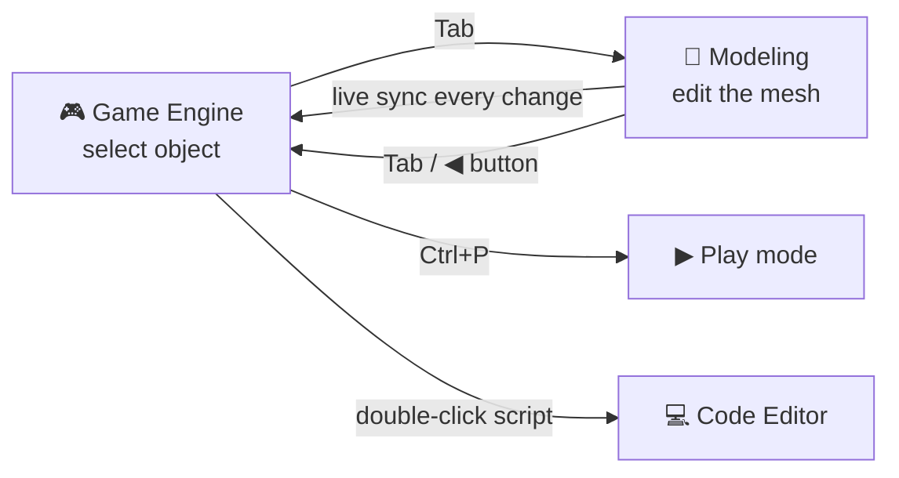
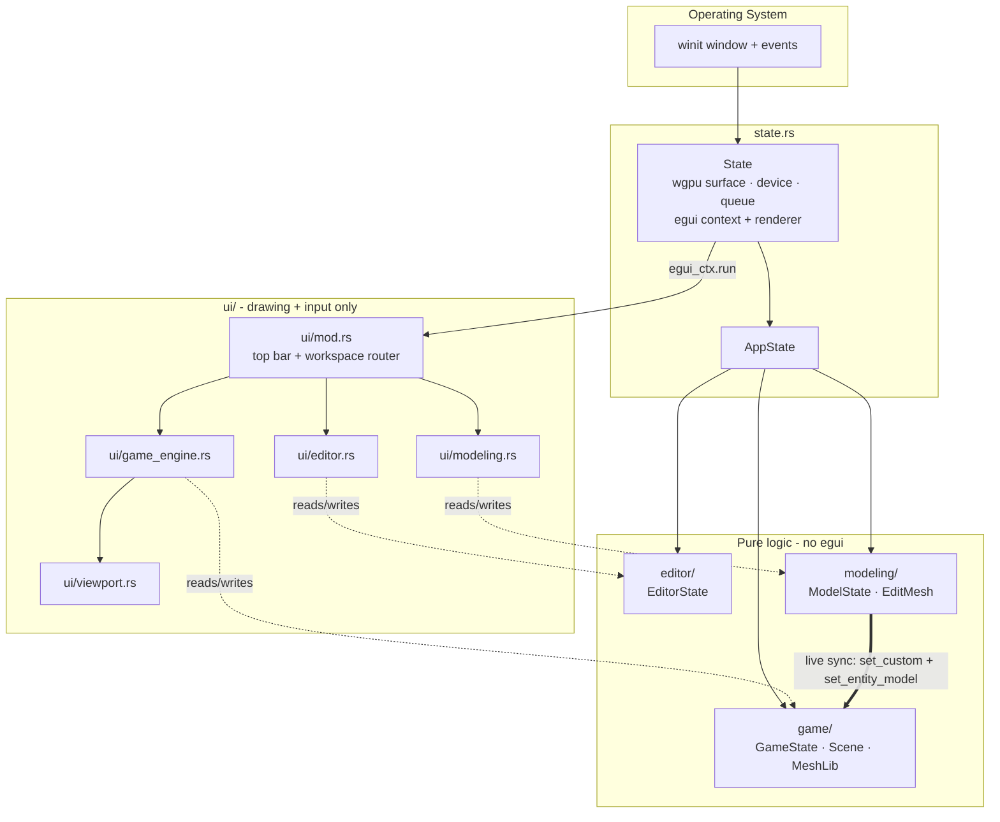
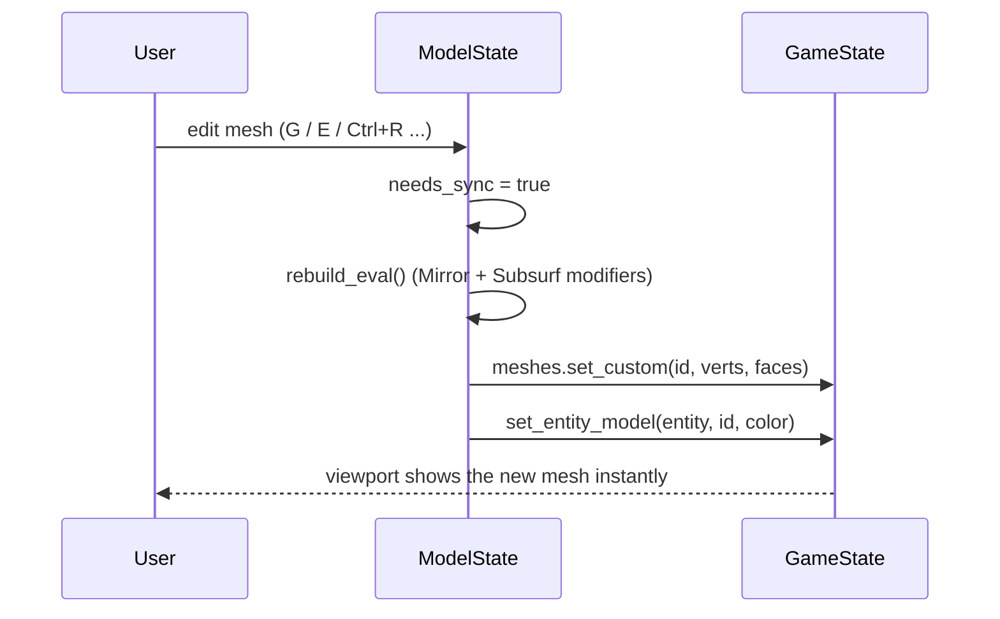

<div align="center">


<a href="https://git.io/typing-svg"></a>
<br/>


**One window. Three workspaces. Zero external engine.**

[Quick Start](#-quick-start) •
[Features](#-features) •
[Controls](#-controls-cheat-sheet) •
[Architecture](#-architecture) •
[Extending](#-how-to-extend-the-engine) •
[Roadmap](#-roadmap) •
[Contributing](#-contributing)

</div>

---

## 📖 Table of Contents

- [What is LoadEngine?](#-what-is-loadengine)
- [Features](#-features)
- [Quick Start](#-quick-start)
- [Using the Engine (Workflow)](#-using-the-engine-workflow)
- [Controls Cheat Sheet](#-controls-cheat-sheet)
- [Architecture](#-architecture)
- [Project Structure](#-project-structure)
- [Module Guide (code walkthrough)](#-module-guide-code-walkthrough)
- [How to Extend the Engine](#-how-to-extend-the-engine)
- [Design Principles](#-design-principles)
- [Known Limitations](#-known-limitations)
- [Roadmap](#-roadmap)
- [Troubleshooting](#-troubleshooting)
- [Contributing](#-contributing)
- [License](#-license)

---

## 🚀 What is LoadEngine?

LoadEngine is a **game-development studio that lives in a single window and a single Rust binary.**
Instead of juggling separate programs for building scenes, shaping models and writing scripts, LoadEngine puts them side by side and lets them work on the **same live data.**

| Workspace          | What it's for                                                                                                                |
| ------------------ | ---------------------------------------------------------------------------------------------------------------------------- |
| 🎮 **Game Engine** | Compose scenes, arrange objects in a hierarchy, tune components in the Inspector, fly around a 3D viewport and hit **Play**  |
| 🧊 **Modeling**    | Shape the meshes of your game objects with a full edit-mode toolkit: extrude, inset, loop cut, subdivide, modifiers and more |
| 💻 **Code Editor** | Write and organize your game scripts with highlighting, tabs, search and a built-in console                                  |

### 💡 The idea behind LoadEngine

- 🪟 **One project, one window.** No export–import dance between tools. Select an object, press `Tab`, and you are inside its mesh.
- ⚡ **Live by default.** Edit a model and the game viewport updates in the same frame. Press Play, change your mind, press Stop, and everything snaps back.
- 🪶 **Small and understandable.** A lightweight Rust codebase where every part has one clear job, so you can read it, trust it and change it.
- 🌱 **Built to grow.** Logic is separated from drawing, so new workspaces, components, tools and even a new renderer can be added without rewriting the rest.

> ⚠️ **Early alpha.** The architecture is solid and extensible, but many features are intentionally minimal. See [Known Limitations](#-known-limitations) and the [Roadmap](#-roadmap).

---

## ✨ Features

### 🎮 Game Engine workspace

- 🌳 **Hierarchy tree** with search, show/hide, collapse, parenting, duplicate, delete, right-click menu
- 🔍 **Inspector** with Transform + components (Mesh Renderer, Light, Camera, Script, Spin, Rigidbody)
- 🖼️ **3D viewport** (software renderer on egui): Solid / Wireframe / Solid+Wire, directional + point lights, grid, axis widget
- 🧭 **Fluid editor camera**: orbit, pan, zoom, fly mode (`RMB` + `WASD`), focus (`F`)
- ✥ **Gizmos**: Move / Rotate / Scale with optional snapping
- ▶️ **Play mode**: Play / Pause / Stop, scene is restored on Stop, simple gravity + bounce physics, renders from the `Main Camera`
- ↶ **Undo / Redo** (continuous drags count as one step)
- 📁 **Project panel**: add primitives, list scripts, attach scripts to objects

### 🧊 Modeling workspace

- 🔺 **Vertex / Edge / Face** selection modes, box select, edge-loop select, select linked / more / less / invert
- ✋ **Modal operators**: `G` grab, `R` rotate, `S` scale with axis lock (`X Y Z N`), numeric input, snapping
- 🛠️ **Mesh tools**: Extrude, Inset, Duplicate, Fill, Dissolve, Loop Cut, Subdivide (Catmull-Clark), Poke, Solidify, Triangulate, Smooth, To Sphere, Merge, Flip / Recalculate normals
- 🎚️ **Proportional editing** (mouse wheel changes radius)
- 🧩 **Non-destructive modifiers**: live Mirror (X/Y/Z) and Subdivision Surface (up to level 3)
- 🔗 **Live sync with the Game Engine** (see [workflow](#-using-the-engine-workflow))
- 🎯 **3D cursor**, ortho/perspective, clickable navigation gizmo
- 📦 **OBJ import / export**

### 💻 Code Editor workspace

- 🎨 Custom lexer with **syntax highlighting** (One Dark theme + light theme)
- 📑 Multiple **tabs** with unsaved-changes marker, file explorer for `scripts/`
- ⌨️ **Auto-indent**, auto-close brackets/quotes, multi-line indent/dedent, comment toggle
- 🔎 **Find & Replace** (case-sensitive option, next/previous, replace all)
- 🩺 **Diagnostics** (bracket balance) — click an error in the console to jump to its line
- 📟 Colored **console** with filters, auto-scroll and status bar (line/column/selection)

---

## ⚡ Quick Start

### Requirements

- **Rust 1.85 or newer** (the project uses `edition = "2024"`)
- A GPU/driver supporting Vulkan, Metal or DirectX 12 (needed by `wgpu`)
- Windows, Linux or macOS

```bash
# 1. Install / update Rust
rustup update

# 2. Clone
git clone https://github.com/danielSeSa/LoadEngine.git
cd LoadEngine

# 3. Run (release mode is much smoother)
cargo run --release
```

Run the unit tests (mesh topology checks):

```bash
cargo test
```

On first launch the engine creates a `scripts/` folder with a sample `main.les` script. That folder is git-ignored.

### Dependencies

```toml
[dependencies]
winit      = "0.29"   # window + events
wgpu       = "0.19"   # GPU surface
pollster   = "0.3"    # block_on for async init
glam       = "0.24"   # math (Vec3, Mat4, Quat)
egui       = "0.26"   # UI
egui-winit = "0.26"
egui-wgpu  = "0.26"
```

> The versions of `wgpu`, `winit` and `egui*` are tightly coupled. **Keep them exactly as listed** unless you migrate all of them together.

---

## 🎬 Using the Engine (Workflow)



### 1️⃣ Build a scene

1. Open the **Game Engine** tab. A demo scene is already loaded.
2. Use **＋ Create** in the Hierarchy (or the Project panel) to add Empty objects, primitives, lights and cameras.
3. Select objects by clicking in the viewport or in the Hierarchy.
4. Move / rotate / scale with `W` / `E` / `R` and the gizmo. Enable **Snap** for precise values.
5. Fine-tune values in the **Inspector**. Use **➕ Add Component** to attach behaviors.

### 2️⃣ Model an object (live)

1. Select an object and press **`Tab`** (or right-click → _Edit in Modeling_, or _Inspector → Edit in Modeling_).
2. The object's mesh opens in the Modeling workspace.
3. Edit it (`E` extrude, `Ctrl+R` loop cut, `I` inset...). **The game viewport updates instantly.**
4. Press **`Tab`** again to go back.

Good to know:

- If several objects share one mesh, editing creates an **independent copy** first, so other objects are never changed by accident.
- **Send as new** pushes the current mesh to the scene as a new object. **Separate** moves the selected faces into a new object.
- **Origin → Bottom** makes the model sit correctly on the ground in Play mode.
- Mirror and Subdivision modifiers are non-destructive. Use **Apply modifiers** to bake them.

### 3️⃣ Test in Play mode

Press **`Ctrl+P`**. Objects with a _Rigidbody_ fall and bounce, _Spin_ rotates, and the view switches to the first active _Camera_. Press **Stop** and the scene returns to exactly how it was.

### 4️⃣ Write scripts

Open the **Code Editor**, create a script (`Ctrl+N`), save (`Ctrl+S`), then attach it from the Project panel (right-click → _Attach to selected object_).

> 📝 Scripts are **not executed yet.** Attaching works and is logged on Play, but no interpreter is wired in. See the [Roadmap](#-roadmap) (Rhai integration is the planned next step).

---

## 🎹 Controls Cheat Sheet

<details open>
<summary><b>🎮 Game Engine</b></summary>

| Action                              | Input                                         |
| ----------------------------------- | --------------------------------------------- |
| Select / Move / Rotate / Scale tool | `Q` / `W` / `E` / `R`                         |
| Orbit camera                        | `RMB` drag, or `Alt` + `LMB`                  |
| Pan camera                          | `MMB` drag                                    |
| Zoom                                | Mouse wheel                                   |
| Fly                                 | Hold `RMB` + `W A S D Q E` (`Shift` = faster) |
| Focus selected                      | `F`                                           |
| Duplicate / Delete                  | `Ctrl+D` / `Del`                              |
| Undo / Redo                         | `Ctrl+Z` / `Ctrl+Y` (or `Ctrl+Shift+Z`)       |
| Play / Stop                         | `Ctrl+P`                                      |
| Edit mesh in Modeling               | `Tab`                                         |
| Uniform scale (Scale gizmo)         | Hold `Shift`                                  |

</details>

<details open>
<summary><b>🧊 Modeling</b></summary>

| Action                             | Input                                         |
| ---------------------------------- | --------------------------------------------- |
| Vertex / Edge / Face mode          | `1` / `2` / `3`                               |
| Select all / none / invert         | `A` / `Alt+A` / `Ctrl+I`                      |
| Select linked                      | `L`                                           |
| Edge loop select                   | `Alt` + `LMB`                                 |
| Box select                         | `LMB` drag (`Shift` adds)                     |
| Grab / Rotate / Scale              | `G` / `R` / `S`                               |
| Lock axis (while transforming)     | `X` / `Y` / `Z` / `N` (normal)                |
| Numeric input (while transforming) | Type digits, `Backspace`                      |
| Snap                               | Hold `Ctrl`                                   |
| Confirm / Cancel                   | `LMB` or `Enter` / `Esc` or `RMB`             |
| Extrude                            | `E`                                           |
| Inset                              | `I`                                           |
| Duplicate faces                    | `Shift+D`                                     |
| Fill (make face)                   | `F`                                           |
| Dissolve edges                     | `Ctrl+X`                                      |
| Delete                             | `X` or `Del`                                  |
| Loop cut                           | `Ctrl+R`                                      |
| Merge at center                    | `M`                                           |
| Recalculate normals                | `Shift+N`                                     |
| Proportional editing               | `O` (wheel changes radius while transforming) |
| Ortho / Perspective                | `5`                                           |
| Frame selected                     | `Home`                                        |
| X-Ray                              | `Alt+Z`                                       |
| Back to Game Engine                | `Tab`                                         |
| Context menu                       | `RMB` click                                   |

</details>

<details>
<summary><b>💻 Code Editor</b></summary>

| Action               | Input                |
| -------------------- | -------------------- |
| Save                 | `Ctrl+S`             |
| Run (build check)    | `F5` or `Ctrl+Enter` |
| Find / Replace       | `Ctrl+F`             |
| New file / Close tab | `Ctrl+N` / `Ctrl+W`  |
| Indent / Dedent      | `Tab` / `Shift+Tab`  |
| Toggle comment       | `Ctrl+/`             |

</details>

---

## 🏛️ Architecture

LoadEngine follows one rule: **logic is pure, UI is thin.**
Data structures and algorithms live in modules that do **not** depend on egui. The `ui/` modules only draw state and forward input.



### Frame lifecycle

1. `winit` delivers events → `State::handle_event` forwards them to `egui-winit`.
2. On `RedrawRequested`, `State::render()`:
   1. acquires the swapchain texture,
   2. runs **`ui::draw(ctx, &mut app)`** (builds the whole UI),
   3. tessellates egui shapes and uploads them,
   4. renders everything in one render pass and presents.
3. `AboutToWait` requests the next redraw (continuous loop).

### Live sync (Modeling → Game)



### Undo/Redo strategy

| System     | Strategy                                                                                                                                        |
| ---------- | ----------------------------------------------------------------------------------------------------------------------------------------------- |
| Game scene | Snapshot of the whole `Scene` before each frame; committed only if changed. Drags are merged into one step via a "gesture" flag. Max 100 steps. |
| Modeling   | Snapshot of `EditMesh` before every operator. Max 40 steps.                                                                                     |

Snapshots are simple and bug-resistant. When scenes grow large, swap them for command-based (delta) undo.

---

## 🗂️ Project Structure

```
LoadEngine/
├── Cargo.toml
├── README.md
├── .gitignore
└── src/
    ├── main.rs                 # entry point + winit event loop
    ├── state.rs                # wgpu/egui setup, AppState, render()
    │
    ├── editor/                 # 💻 code editor logic (pure)
    │   ├── mod.rs              #   EditorState: tabs, files, save, run, find/replace
    │   ├── document.rs         #   one open file (text, selection, diagnostics)
    │   ├── edit.rs             #   pure text ops: newline, auto-close, indent, comment
    │   ├── lexer.rs            #   tokenizer for syntax highlighting
    │   ├── diagnostics.rs      #   bracket-balance checker
    │   ├── console.rs          #   log entries + filters
    │   └── find.rs             #   find state + byte→char range conversion
    │
    ├── game/                   # 🎮 game engine logic (pure)
    │   ├── mod.rs              #   Scene, Entity, Component, GameState, Play mode, undo
    │   └── mesh.rs             #   Primitive enum, Mesh, MeshLib (incl. Custom meshes)
    │
    ├── modeling/               # 🧊 mesh modeling logic (pure)
    │   ├── mod.rs              #   ModelState, camera math, modal operators, live sync
    │   ├── mesh.rs             #   EditMesh: topology, selection, core operators, primitives, OBJ
    │   └── ops.rs              #   extra operators: fill, dissolve, poke, solidify, loops...
    │
    └── ui/                     # 🖌️ egui drawing + input only
        ├── mod.rs              #   top bar + workspace router
        ├── game_engine.rs      #   toolbar, hierarchy, inspector, project/console
        ├── viewport.rs         #   3D software renderer, picking, gizmos
        ├── modeling.rs         #   modeling panels + viewport
        └── editor.rs           #   code editor UI (gutter, highlighting, find bar)
```

---

## 🔬 Module Guide (code walkthrough)

### `main.rs` and `state.rs`

- `main.rs` creates the window and runs the event loop. It contains no engine logic.
- `State` owns all GPU resources (`wgpu::Surface`, `Device`, `Queue`) and the egui context/renderer.
- `AppState` owns the three workspaces' data and the active tab:

```rust
pub struct AppState {
    pub active_workspace: Workspace,   // GameEngine | Modeling | CodeEditor
    pub editor: EditorState,
    pub game: GameState,
    pub modeling: ModelState,
}
```

### `game/` — scene and components

- **`Scene`** stores a flat `Vec<Entity>`; hierarchy is expressed with `parent: Option<EntityId>`. World matrices are computed by walking up the parent chain (with cycle guards).
- **`Entity`**: `id`, `name`, `parent`, `pos`, `rot` (Euler degrees, YXZ), `scale`, `active`, `components`.
- **`Component`** is an enum:

```rust
pub enum Component {
    Mesh { prim: Primitive, color: [f32; 3] },
    Light { kind: LightKind, color: [f32; 3], intensity: f32 },
    Camera { fov: f32 },
    Script { path: String },
    Spin { speed: f32 },
    Rigidbody { gravity: bool, bounce: f32 },
}
```

- **`Primitive`** is `Cube | Sphere | Cylinder | Pyramid | Plane | Custom(u32)`. `Custom(id)` points to a mesh created in Modeling and stored in `MeshLib`.
- **`GameState`** holds the scene, selection, tool, camera, undo/redo, Play-mode state and the mesh library. `play()` stores a backup of the scene, `stop()` restores it, `step(dt)` runs the simple simulation.

### `game/mesh.rs`

`MeshLib` is a `HashMap<Primitive, Mesh>` with built-in shapes. `set_custom()` registers or replaces user meshes. `get()` falls back to the cube if an id is missing, so a bad reference never crashes rendering.

### `modeling/mesh.rs` — `EditMesh`

A compact face-vertex mesh designed for fast editing and easy extension (all code is original):

```rust
pub struct EditMesh {
    pub verts: Vec<Vec3>,
    pub faces: Vec<Vec<u32>>,   // polygons (tris / quads / n-gons)
    pub edges: Vec<Edge>,       // derived cache: (a, b, face0, face1)
    pub sel_v: HashSet<u32>,    // selection is stored on vertices ...
    pub sel_f: HashSet<u32>,    // ... and faces, kept consistent by flush_* functions
}
```

- `rebuild_edges()` regenerates the edge cache after any topology change (never per frame).
- `u32` indices keep memory small; `NONE = u32::MAX` marks "no face" (boundary edge).
- Core operators: delete, extrude, inset, loop cut (edge-ring walk), Catmull-Clark subdivide, weld, merge, flip, recalc normals (flood-fill + signed volume), triangulate, smooth, mirror, primitives, OBJ I/O.
- `modeling/ops.rs` adds more operators as an `impl EditMesh` block (Union-Find is used for linked selection and face merging).
- Unit tests at the bottom check Euler characteristic and face counts.

### `modeling/mod.rs` — `ModelState`

- Camera math (`Cam`) supports perspective and orthographic projection.
- **Modal operators** (`Modal`) store original positions so every mouse move is recomputed from the start state (no drift). Cancel simply restores the undo snapshot.
- **Proportional editing** adds nearby vertices with a smoothstep weight.
- `load_entity()` opens a game object; `sync()` pushes the evaluated mesh (with modifiers) back every frame it changed.
- Per-frame buffers (`proj`, `front`, `fnorm`, `fcen`...) are reused to avoid allocations.

### `editor/` — code editor

- `edit.rs` contains **pure functions on `String`** with `char` indices (not byte indices), so they are easy to test.
- `lexer.rs` produces non-overlapping tokens that cover the entire text; `ui/editor.rs` turns them into an egui `LayoutJob`.
- `ui/editor.rs` uses a two-layer scroll area: vertical scroll moves gutter and text together; horizontal scroll affects only the text, so the line-number gutter stays fixed.

### `ui/viewport.rs` — software 3D renderer

Draws the scene with egui's painter: project vertices → back-face cull → painter's-algorithm sort → flat-lit polygons. Also implements ray-triangle picking and gizmo hit-testing. It is simple, dependency-free and good for hundreds of objects, but it is the first thing to replace with real GPU rendering (see Roadmap).

---

## 🧰 How to Extend the Engine

### ➕ Add a new workspace

1. Add a variant to `enum Workspace` in `state.rs`.
2. Add a line to `TABS` in `ui/mod.rs`.
3. Add a `match` arm in `ui::draw`.
4. Create your `ui/my_workspace.rs` and (optionally) a pure-logic `my_workspace/` module + a field in `AppState`.

### 🧱 Add a new component

1. Add a variant to `Component` in `game/mod.rs`; fill in `name()` and `icon()`, and add it to `templates()`.
2. Draw its fields in the `match comp { ... }` inside `inspector()` in `ui/game_engine.rs`.
3. Give it behavior in `GameState::step()` (and/or the viewport if it should be drawn).

```rust
// game/mod.rs
Component::Health { hp: f32 },

// ui/game_engine.rs  (inspector)
Component::Health { hp } => {
    ui.add(egui::Slider::new(hp, 0.0..=100.0).text("HP"));
}
```

### 🔷 Add a built-in primitive

1. Add a variant to `Primitive` and update `name`, `icon`, `default_color`, and `ALL`.
2. Write a builder function in `game/mesh.rs` and register it in `MeshLib::new()`.

> ⚠️ Rust requires every `match` over `Primitive` to be exhaustive — the compiler will point to each place you need to update.

### 🛠️ Add a mesh operator (Modeling)

1. Write the algorithm as `pub fn my_op(&mut self) -> bool` in `modeling/ops.rs` (return `true` only if something changed).
2. Add a wrapper in `modeling/mod.rs` using the existing helper, which handles undo for you:

```rust
pub fn op_my_op(&mut self) {
    self.apply("My Op", |m| m.my_op());
}
```

3. Add a button in `left_panel()` and/or a key in `hotkeys()` in `ui/modeling.rs`.
4. Add a unit test next to the algorithm. Topology bugs are much easier to catch with `cargo test` than visually.

### 📜 Add a scripting language (recommended next step)

The editor is language-agnostic. To run scripts:

1. Add `rhai = "1"` (or `mlua`) to `Cargo.toml`.
2. Create `src/scripting/mod.rs` that owns the engine, compiles a script and calls `on_start` / `on_update(dt)`.
3. Call it from `GameState::play()` / `step()` for entities that have `Component::Script`.
4. In `EditorState::run_active()`, replace the bracket check with real compile errors and pass `(line, col)` to `console.push(..., Some((line, col)))` so clicking an error jumps to the line.

### 🎨 Add a new syntax-highlighting language

Edit `KEYWORDS` / `TYPES` in `editor/lexer.rs` or add a new `Tok` kind and a color in `palette()` in `ui/editor.rs`.

---

## 🧭 Design Principles

- 🦀 **Safe by default.** No `unsafe`. Index math is guarded; rare failure paths return `false`/`None` instead of panicking.
- 🧱 **Pure core, thin UI.** Everything important can be unit-tested without a window.
- 💾 **Memory-conscious.** `u32` indices, cached edge tables, reused per-frame buffers, bounded undo history, size limits on heavy operators (e.g. Subdivide).
- 🔌 **Replaceable parts.** The renderer, scripting and storage are isolated so they can be swapped without rewriting the rest.
- 🧪 **Original code.** Every algorithm is implemented from scratch, from general knowledge of the techniques. Nothing is copied from other projects, ensuring the intellectual property and licensing of LoadEngine remain clean and protected.

---

## ⚠️ Known Limitations

Being honest helps contributors pick impactful work:

- 🖼️ The viewport is a **software renderer** — fine for hundreds of objects, not for millions of triangles.
- 📜 **Scripts are not executed** (no interpreter yet).
- 💾 **No scene save/load.** Custom meshes live in memory only; use OBJ export to keep them.
- 🧊 Modeling has no **Bevel, Knife, Bridge or Edge Slide** yet; faces only (no loose edges/vertices).
- 🪢 Rotation uses Euler angles (gimbal lock possible); no quaternion editing.
- ⚙️ Physics is a placeholder (gravity + ground bounce only).
- 🔤 The default egui font lacks some glyphs (some icons may look like boxes) and has **no Persian/Arabic** glyphs — load a font with `ctx.set_fonts` if needed.
- 🧪 Early alpha: expect rough edges and breaking changes.

---

## 🗺️ Roadmap

- [ ] 📜 **Rhai scripting** (`on_start`, `on_update`, access to transform) with real errors in the editor
- [ ] 💾 **Scene / project save & load** (JSON via `serde`), including custom meshes
- [ ] 🎨 **GPU renderer** with `wgpu` rendering into a texture shown in the egui viewport
- [ ] 📥 `.obj` / `.gltf` model import into scenes
- [ ] 🖱️ Drag & drop re-parenting and multi-select in the Hierarchy
- [ ] 🧊 Bevel, Knife, Bridge Edge Loops, Edge Slide
- [ ] 🧬 UV editing and textures/materials
- [ ] ⚙️ Real physics (e.g. `rapier3d`)
- [ ] 🔊 Audio, input mapping, build/export of games
- [ ] 🧰 Command-based undo/redo for large scenes
- [ ] ✅ CI (fmt, clippy, tests) on GitHub Actions

---

## 🩹 Troubleshooting

| Problem                                         | Fix                                                                                                                                                                                  |
| ----------------------------------------------- | ------------------------------------------------------------------------------------------------------------------------------------------------------------------------------------ |
| `edition 2024 is unstable / not supported`      | Run `rustup update` (need Rust **1.85+**).                                                                                                                                           |
| `file not found for module ...`                 | Check the folder layout in [Project Structure](#-project-structure). `src/editor/mod.rs`, `src/modeling/mod.rs`, `src/game/mod.rs` and `src/ui/mod.rs` are four **different** files. |
| `non-exhaustive patterns: Primitive::Custom(_)` | A `match` over `Primitive` is missing the `Custom(_)` arm.                                                                                                                           |
| `float_literal_f32_fallback` warnings           | Harmless. Write `1.0_f32`, or put `#![allow(float_literal_f32_fallback)]` as the **very first line** of `main.rs`.                                                                   |
| `scroll_delta` not found                        | In egui 0.26 use `i.raw_scroll_delta`.                                                                                                                                               |
| Mismatched delimiter errors                     | Usually a snippet pasted in the wrong place. Compare with the module guide above.                                                                                                    |
| Icons render as squares                         | Font lacks that glyph; cosmetic only.                                                                                                                                                |
| Black / no window                               | Update GPU drivers; `wgpu` needs Vulkan, Metal or DX12.                                                                                                                              |
| Slow in debug build                             | Use `cargo run --release`.                                                                                                                                                           |

---

## 🤝 Contributing

Contributions of all sizes are welcome — bug reports, docs, tests, and engine features[cite: 3].

1. 🍴 **Fork** the repo (solely for developing and submitting contributions to this official repository) and create a branch: `git checkout -b feature/my-feature`[cite: 3]
2. 🧪 Make sure it builds and tests pass: `cargo test`[cite: 3]
3. 🎨 Format and lint[cite: 3]:
   ```bash
   cargo fmt
   cargo clippy
   ```
4. 💬 Commit with a clear message and open a **Pull Request** describing *what* and *why*[cite: 3].

**Guidelines & Contributor Agreement**

- Put logic in the pure modules (`game/`, `modeling/`, `editor/`), and drawing/input in `ui/`[cite: 3].
- Add a unit test for any new topology or text algorithm[cite: 3].
- Do **not** copy code from third-party projects (especially GPL/AGPL-licensed projects). Implement algorithms from your own understanding or permissively licensed sources[cite: 3].
- Never commit secrets, personal paths, or large binary assets[cite: 3].
- **License Agreement:** By submitting a Pull Request or contribution to LoadEngine, you agree to the terms of Section 3 of the [LoadEngine Community Source-Available License (LCSAL) v1.0](LICENSE) and grant the project owner full rights to integrate, maintain, and distribute your contribution as part of LoadEngine.

🌱 **Good first issues:** fix a typo in a tooltip, add a primitive, add a keyboard shortcut, write a test for a mesh operator, or improve the documentation[cite: 3].

---

## 📄 License

LoadEngine is licensed under the **LoadEngine Community Source-Available License (LCSAL) v1.0** — see the [LICENSE](LICENSE) file for full details.

- ✅ **Free to use** for personal, educational, and commercial games/projects (zero royalties).
- ✅ **Source-available** — inspect the code, submit bug fixes, and contribute via Pull Requests.
- ⚠️ **Attribution required** — distributed games must display the *"Made with LoadEngine"* splash screen or logo.
- ❌ **No redistribution or rebranding** — you may not republish or sell the engine itself or present a fork as an independent engine.


---

<div align="center">

### ⭐ If you like the project, give it a star — it helps a lot!

Made with 🦀 Rust, ☕ coffee and a lot of curiosity.


</div>
